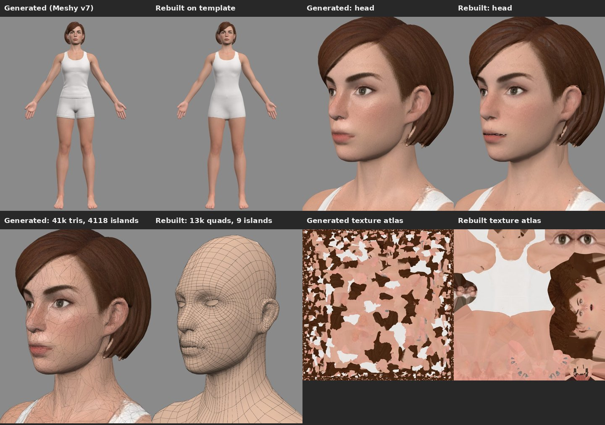
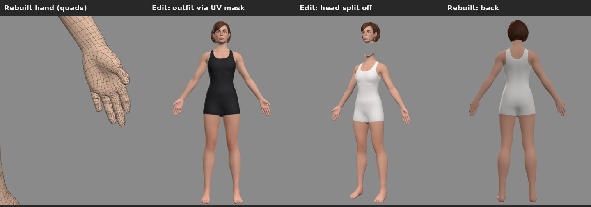
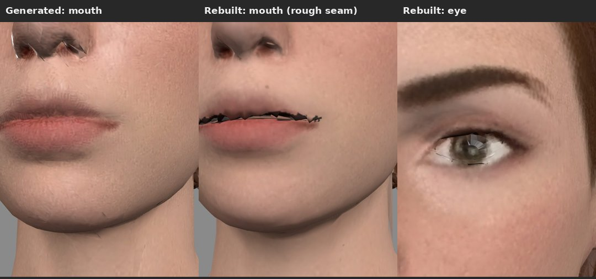

# character-rebuild

A generated character (image-to-3D output) re-fitted onto a clean quad template body and re-baked, so it can
be edited the way a hand-made asset can: fixed UV layout, face split from the body, texture edits in UV space.

| | Generated (Meshy v7) | Rebuilt |
|---|---|---|
| geometry | 41,382 tris, one blob | 13,378 quads, Head / Body groups |
| UV islands | 4,118 | 9 (fixed layout) |
| face split | no | yes, own mesh + own texture |
| texture edits | break across islands | one mask in UV space |

## result/

| file | what |
|---|---|
| `original_meshy_output.glb` | the generated mesh as it came out of Meshy v7 |
| `rebuilt_white_outfit.glb` | **the rebuilt character.** Body + Head on template topology, baked 2048 texture, two eye patches, hair shell |
| `rebuilt_black_outfit.glb` | same mesh, outfit recoloured with a UV mask (`texture_black_outfit.png`) |
| `rebuilt_head_split_exploded.glb` | head as its own mesh with its own texture, lifted 16 cm to show the split |
| `rebuilt_body_quads.obj` | quad mesh with UVs; groups `Head`, `Body`, `EyeSockets_hidden` |
| `texture_*.png` | baked base colour, outfit variant, head-only, body-only |
| `metrics.json` | fit distances and counts |
| `board1-3.jpg` | comparison renders |

All files are data (glTF binary, OBJ text, PNG, JPG, JSON); none can contain executable code. GitHub renders
`.glb` files in a 3D viewer in the browser. SHA-256 checksums for every file are in `CHECKSUMS.txt`.

**Fit accuracy** (scan surface → rebuilt surface, excluding hair): median 0.8 mm, 95th percentile 6.4 mm on a
1.9 m figure. Known rough spots in this first pass: the lip seam is slightly jagged, lid edges have small
artifacts, no normal map is baked yet so fine cloth detail is smoothed, and the scalp under the hair carries hair colour.
